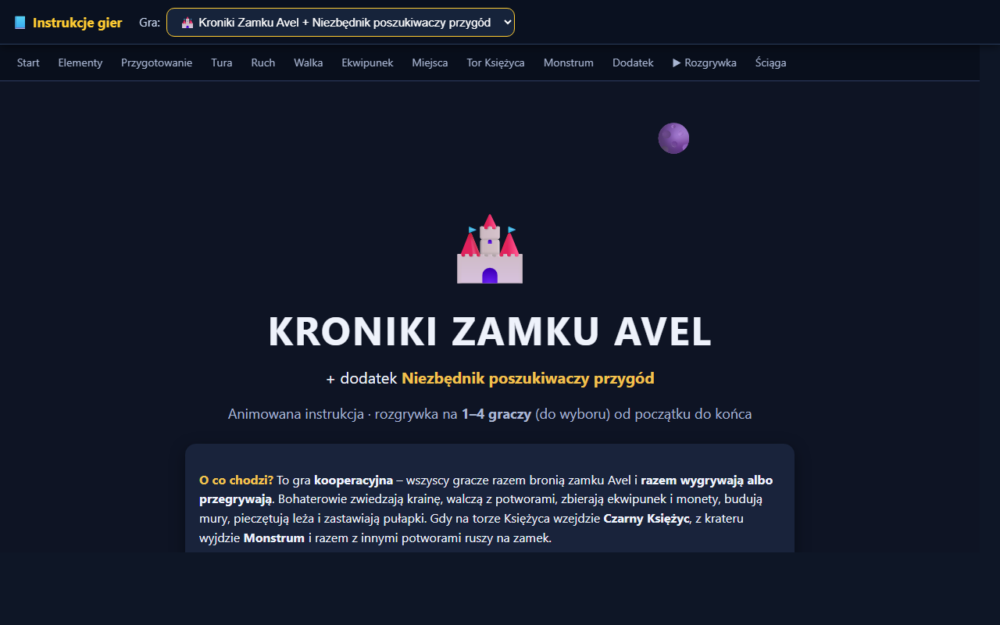
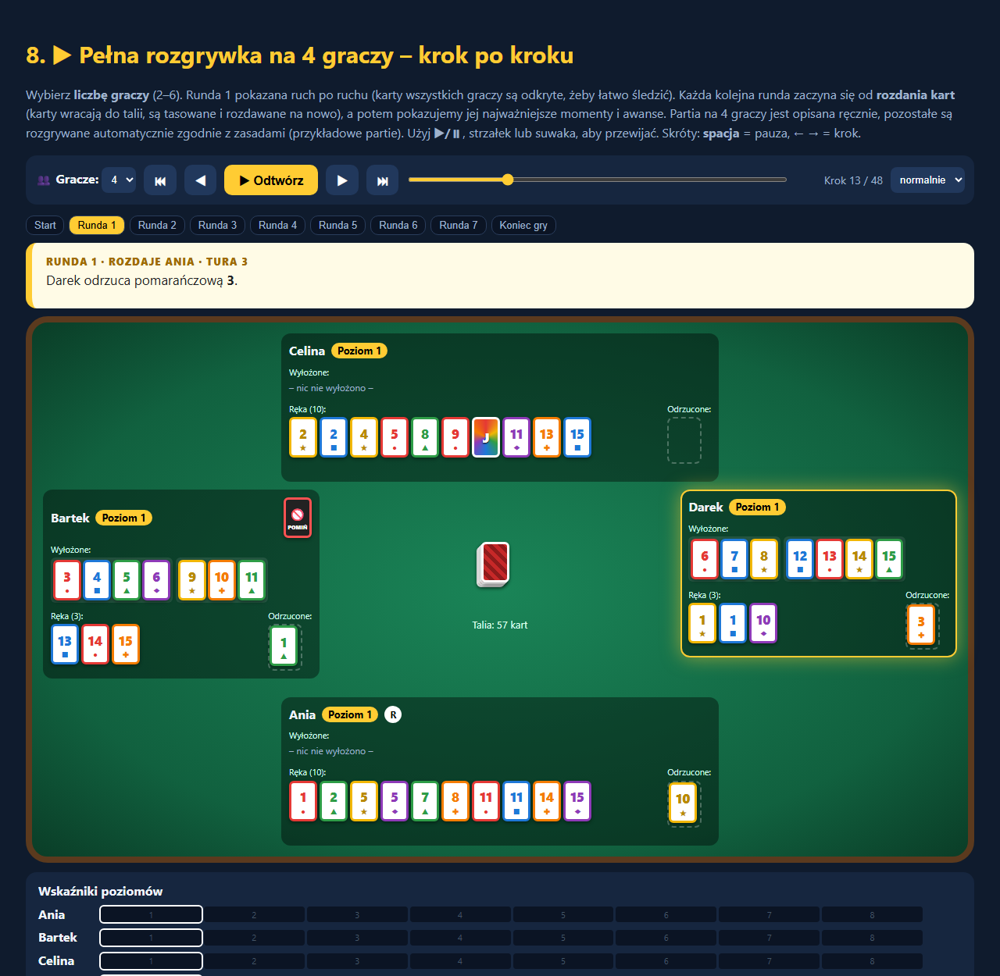
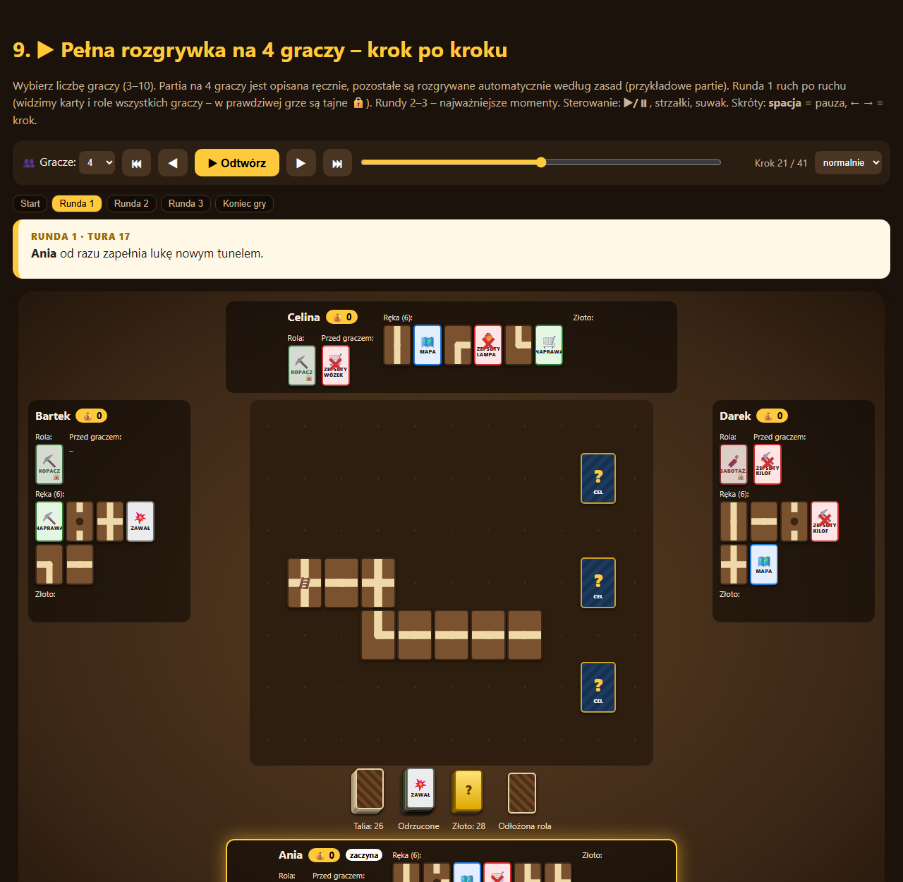
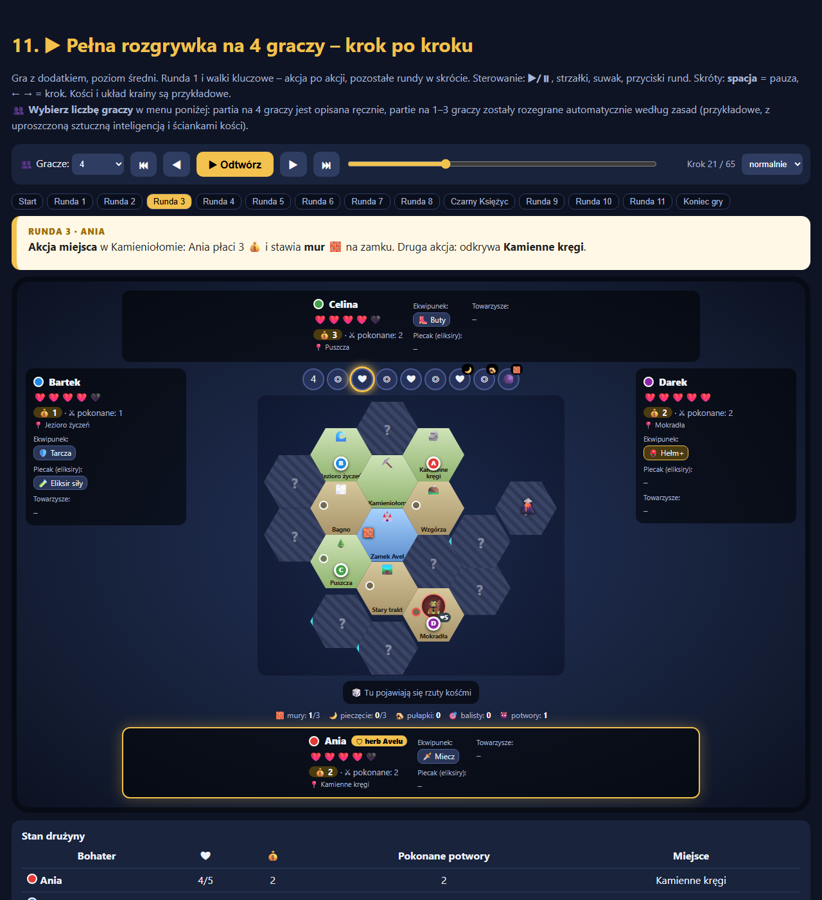
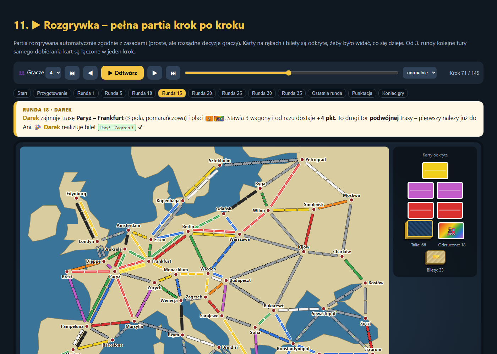
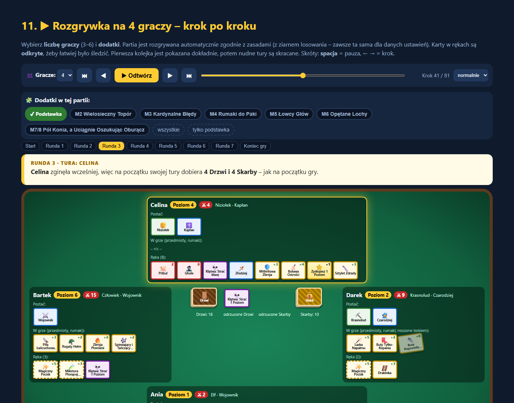

# 🎲 Instrukcje gier planszowych

Animowane, interaktywne instrukcje pięciu gier, w całości **po polsku**, zebrane w **jednym pliku HTML**:

| Gra | Wydawca | Liczba graczy w symulacji |
|---|---|---|
| 🃏 **Level 8** | Ravensburger | 2–6 |
| ⛏️ **Sabotażysta** | G3 / AMIGO | 3–10 |
| 🏰 **Kroniki Zamku Avel** + dodatek **Niezbędnik poszukiwaczy przygód** | Rebel / Board Game Box | 1–4 |
| 🚂 **Wsiąść do Pociągu: Europa** | Days of Wonder / Rebel | 2–5 |
| ⚔️ **Munchkin** + dodatki 2–8 (do wyboru, które są w grze) | Steve Jackson Games / Black Monk | 3–6 |
Każda instrukcja tłumaczy zasady krok po kroku (z animacjami) i pokazuje **pełną przykładową partię od początku do końca**. Partię można odtwarzać, pauzować i przewijać, a liczbę graczy wybiera się z listy.



---

## 🚀 Jak uruchomić

### Online

Otwórz stronę **https://pmoszczy1989-bot.github.io/Instrukcje_Gry_Planszowe/** (GitHub Pages). Linki do konkretnych gier: [Level 8](https://pmoszczy1989-bot.github.io/Instrukcje_Gry_Planszowe/#level8) · [Sabotażysta](https://pmoszczy1989-bot.github.io/Instrukcje_Gry_Planszowe/#sabotazysta) · [Kroniki Zamku Avel](https://pmoszczy1989-bot.github.io/Instrukcje_Gry_Planszowe/#avel) · [Wsiąść do Pociągu: Europa](https://pmoszczy1989-bot.github.io/Instrukcje_Gry_Planszowe/#ttr) · [Munchkin](https://pmoszczy1989-bot.github.io/Instrukcje_Gry_Planszowe/#munchkin).

### Lokalnie

1. Pobierz plik [`instrukcje_gier.html`](instrukcje_gier.html) (lub sklonuj repozytorium).
2. Otwórz go w przeglądarce (Edge, Chrome, Firefox).
3. Z listy **„Gra:”** na górze strony wybierz grę.

Nie trzeba niczego instalować ani mieć dostępu do internetu: plik jest w pełni samodzielny i nie korzysta z zewnętrznych bibliotek, czcionek ani obrazków.

```powershell
gh repo clone pmoszczy1989-bot/Instrukcje_Gry_Planszowe
start .\Instrukcje_Gry_Planszowe\instrukcje_gier.html
```

**Bezpośrednie linki do gier** (dopisz kotwicę do adresu pliku):

| Kotwica | Gra |
|---|---|
| `instrukcje_gier.html#level8` | Level 8 |
| `instrukcje_gier.html#sabotazysta` | Sabotażysta |
| `instrukcje_gier.html#avel` | Kroniki Zamku Avel |
| `instrukcje_gier.html#ttr` | Wsiąść do Pociągu: Europa |
| `instrukcje_gier.html#munchkin` | Munchkin + dodatki |

---

## ✨ Możliwości

- **Animowane zasady**: rozdawanie kart, układy, plansza, walka, tor Księżyca itd.
- **Pełna rozgrywka krok po kroku** z planszą, rękami graczy i komentarzem do każdego ruchu.
- **Sterowanie**: ▶/⏸, krok w przód i w tył, suwak, przyciski skoku do rund, regulacja tempa.
- **Skróty klawiszowe**: `spacja` (odtwórz/pauza), `←` / `→` (krok).
- **Wybór liczby graczy** dla każdej gry.
- **Wybór dodatków** w Munchkinie: zasady i przykładowa partia dopasowują się do wybranych dodatków.
- **Ściąga** z najważniejszymi zasadami na końcu każdej instrukcji.
- Układ **responsywny**, działa też na tablecie i telefonie.

| Level 8 | Sabotażysta | Kroniki Zamku Avel |
|---|---|---|
|  |  |  |

| Wsiąść do Pociągu: Europa | Munchkin + dodatki |
|---|---|
|  |  |

---

## 📚 Dokumentacja

| Dokument | Zawartość |
|---|---|
| [Obsługa](docs/obsluga.md) | Jak korzystać z instrukcji: wybór gry, sterowanie symulacją, skróty. |
| [Level 8](docs/level8.md) | Streszczenie zasad i opis przykładowej partii. |
| [Sabotażysta](docs/sabotazysta.md) | Streszczenie zasad i opis przykładowej partii. |
| [Kroniki Zamku Avel](docs/kroniki-zamku-avel.md) | Streszczenie zasad gry i dodatku oraz opis przykładowej partii. |
| [Wsiąść do Pociągu: Europa](docs/wsiasc-do-pociagu-europa.md) | Streszczenie zasad, punktacja i opis przykładowej partii. |
| [Munchkin + dodatki](docs/munchkin.md) | Streszczenie zasad, opis dodatków i wyboru dodatków, przykładowa partia. || [Budowa techniczna](docs/budowa-techniczna.md) | Jak zbudowany jest plik, silnik symulacji i generatory partii. |
| [Edycja i rozwój](docs/edycja.md) | Jak wypakować, zmienić i ponownie zbudować instrukcje. |

---

## 🗂️ Struktura repozytorium

```text
Instrukcje_Gry_Planszowe/
├── instrukcje_gier.html      ← cała aplikacja (jedyny potrzebny plik)
├── index.html                ← przekierowanie dla GitHub Pages
├── README.md
├── docs/                     ← dokumentacja i zrzuty ekranu
│   ├── obsluga.md
│   ├── level8.md
│   ├── sabotazysta.md
│   ├── kroniki-zamku-avel.md
│   ├── wsiasc-do-pociagu-europa.md
│   ├── munchkin.md
│   ├── budowa-techniczna.md
│   ├── edycja.md
│   └── img/
└── narzedzia/                ← skrypty do edycji (Python 3)
    ├── rozpakuj.py
    └── zbuduj.py
```

---

## ⚠️ Zastrzeżenia

- To **nieoficjalne** materiały pomocnicze przygotowane do nauki zasad. Nazwy gier i prawa do nich należą do ich wydawców. Instrukcje nie zawierają grafik z oryginalnych gier; wszystkie ilustracje to emoji i CSS.
- W grach Level 8, Sabotażysta i Kroniki Zamku Avel partie na **4 graczy** są opisane ręcznie. W Wsiąść do Pociągu i Munchkinie wszystkie partie, a w pozostałych grach partie dla **innych liczb graczy**, są rozgrywane **automatycznie** przez uproszczony silnik zgodny z zasadami. To przykłady przebiegu gry, a nie zapis optymalnej strategii.
- W **Kronikach Zamku Avel** część elementów jest przykładowa: układ krainy, ścianki kości oraz kafle i potwory zależne od liczby graczy. Szczegóły w [dokumentacji gry](docs/kroniki-zamku-avel.md#uproszczenia).
- W **Wsiąść do Pociągu: Europa** sieć tras jest odtworzona, ale nie porównana z drukowaną planszą. W **Munchkinie** część nazw i statystyk kart (zwłaszcza z dodatków) jest przykładowa. Szczegóły w dokumentacji obu gier.
- W razie wątpliwości rozstrzyga **oryginalna instrukcja** dołączona do gry.
