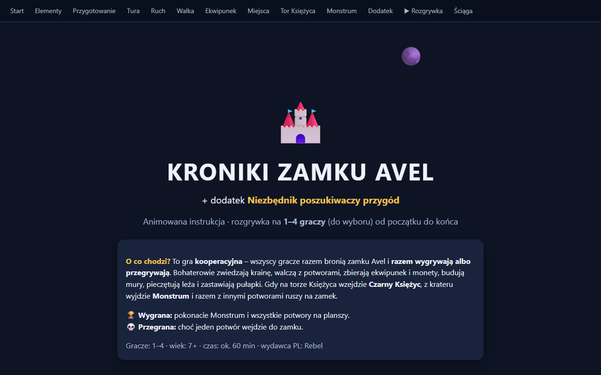

# 🏰 Kroniki Zamku Avel + Niezbędnik poszukiwaczy przygód

[← README](../README.md)

## O grze

**Kooperacyjna** gra przygodowa dla **1–4 graczy**: wszyscy razem bronią zamku Avel i razem wygrywają albo przegrywają. Bohaterowie zwiedzają krainę, walczą z potworami, zbierają ekwipunek i monety, budują mury, pieczętują leża i zastawiają pułapki. Gdy na torze Księżyca wzejdzie **Czarny Księżyc**, z krateru wychodzi **Monstrum** i razem z innymi potworami rusza na zamek.

Instrukcja obejmuje grę podstawową oraz dodatek **„Niezbędnik poszukiwaczy przygód”**.

## Rozdziały instrukcji

1. Elementy gry
2. Przygotowanie gry
3. Przebieg rundy i tura gracza
4. Ruch i odkrywanie krainy
5. Walka
6. Ekwipunek, eliksiry i plecak
7. Akcje miejsc (kafle z zieloną wstęgą)
8. Koniec rundy i tor Księżyca
9. Wzejście Czarnego Księżyca i Monstrum
10. Dodatek: Niezbędnik poszukiwaczy przygód
11. ▶ Pełna rozgrywka krok po kroku
12. Ściąga

## Streszczenie zasad

| Temat | Zasada |
|---|---|
| **Cel** | Razem pokonać Monstrum i wszystkie potwory, zanim któryś wejdzie do zamku. |
| **Liczba graczy** | 1–4. W grze solo gracz ma 4 akcje na turę. Kafle z oznaczeniem 2+/3+/4 bierze się tylko przy tylu graczach. Astrolabium startuje na polu dla Waszej liczby graczy. |
| **Tura** | 2 akcje: ruch, walka, akcja miejsca albo odpoczynek (+2 ❤). Wymiana przedmiotów i picie eliksirów nie zużywają akcji. |
| **Walka** | Do 3 starć. Rzucasz 2 zielone kości i kości ekwipunku. ⚔ minus 🛡 potwora = obrażenia potwora; 🐾 minus 🛡 bohatera = obrażenia bohatera. Obrażenia się nie leczą same. |
| **Ogłuszenie** | Gdy bohater straci wszystkie ❤: wraca do zamku z pełnymi ❤, traci wszystkie monety i 1 przedmiot, a jego tura się kończy. |
| **Koniec rundy** | Astrolabium przesuwa się o 1 pole: ◎ nowe potwory na pustych leżach · ❤ +1 dla każdego · 🌑 Monstrum. |
| **Czarny Księżyc** | Odkrywa się wszystkie kafle, z krateru wychodzą potwory i Monstrum (14 ❤ przy 1–2 graczach, 17 ❤ przy 3, 20 ❤ przy 4). Od tej pory co rundę potwory maszerują na zamek. |
| **Obrona** | Mury (Kamieniołom) · pieczęcie (Kamienne kręgi) · pułapki (Obóz elfów) · balisty (Pracownia krasnoludzka, z dodatku). |
| **Dodatek** | Eliksiry teleportacji, czasu i ulepszenia · buty · Trzy Córy (1 obrażenie przed walką, potem dołączają jako towarzysz) · balisty · 3 nowe kafle. |

### Marsz potworów (po Czarnym Księżycu)

- Potwory idą do zamku **najkrótszą drogą** w kolejności: małe → duże → Monstrum.
- Zwykły potwór, który trafi na mur, **niszczy 1 mur** i zostaje na miejscu. Monstrum niszczy **wszystkie** mury.
- Pułapki działają tylko na Monstrum.
- Mury można budować najpóźniej w rundzie po wzejściu Czarnego Księżyca.

## Przykładowa partia

- **4 graczy** (Ania, Bartek, Celina, Darek), poziom średni, gra z dodatkiem; partia opisana ręcznie:
  - runda 1 i kluczowe walki są pokazane akcja po akcji, pozostałe rundy w skrócie;
  - drużyna wygrywa.
- **1 (solo), 2 i 3 graczy**: partie rozgrywane automatycznie według zasad, przez uproszczoną sztuczną inteligencję. Przy 1–3 graczach tor Księżyca ma 11 pól, więc gra trwa 2 rundy dłużej niż przy 4 graczach. We wszystkich przykładach bohaterowie wygrywają.

## Uproszczenia

Kilku rzeczy nie da się odtworzyć dokładnie bez fizycznych elementów gry, więc w symulacji są **przykładowe**:

- układ kafli krainy i rozmieszczenie leż;
- ścianki kości (wyniki rzutów odpowiadają mechanice, ale nie są wiernym odwzorowaniem kości);
- kafle pomijane przy mniejszej liczbie graczy:
  - 1 gracz: Alchemik, Wiosła, Jezioro;
  - 2 graczy: Wiosła, Jezioro;
  - 3 graczy: Jezioro;
- dodatkowe potwory z krateru przy 1–3 graczach;
- zasięg balisty (ten sam lub sąsiedni kafel).

W razie rozbieżności rozstrzyga oryginalna instrukcja gry.
