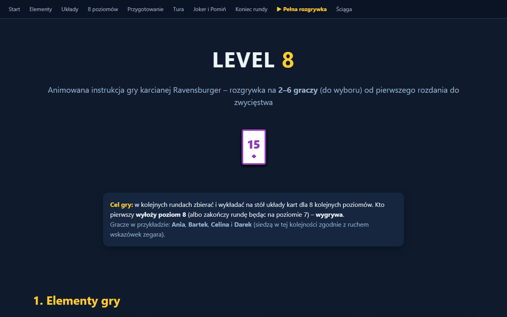

# 🃏 Level 8 (Ravensburger)

[← README](../README.md)

## O grze

Karciana gra dla **2–6 graczy**. W kolejnych rundach gracze zbierają i wykładają na stół układy kart wymagane na swoim poziomie. Wygrywa ten, kto pierwszy **wyłoży poziom 8** (albo zakończy rundę, będąc na poziomie 7).

## Rozdziały instrukcji

1. Elementy gry
2. Rodzaje układów
3. Osiem poziomów
4. Przygotowanie
5. Przebieg tury
6. Joker, Pomiń i brak kart w talii
7. Koniec rundy
8. ▶ Pełna rozgrywka krok po kroku
9. Ściąga

## Streszczenie zasad

### Karty

- Karty z liczbami **1–15** w **6 kolorach**.
- **Jokery**: zastępują dowolną liczbę lub kolor.
- Karty **Pomiń**: zatrzymują wybranego przeciwnika na jedną turę.

### Układy

| Układ | Opis | Przykład |
|---|---|---|
| **Ciąg** | kolejne liczby, kolory dowolne | 4-5-6-7 |
| **Para / trójka / czwórka** | karty o tej samej liczbie | 9-9-9 |
| **Karty w kolorze** | karty jednego koloru, liczby dowolne | 2-7-11 niebieskie |

### Osiem poziomów

| Poziom | Wymagane układy |
|---|---|
| 1 | 2 ciągi po 3 karty |
| 2 | 4 pary |
| 3 | 1 ciąg z 3 kart + 4 karty w jednym kolorze |
| 4 | 1 ciąg z 6 kart + 1 para |
| 5 | 1 ciąg z 7 kart |
| 6 | 1 para + 2 trójki |
| 7 | 1 trójka + 5 kart w jednym kolorze |
| 8 | 1 para + 1 trójka + 1 czwórka |

### Przebieg rundy

1. Rozdający tasuje karty i daje każdemu graczowi **10 kart**. Odkrywa wierzchnią kartę talii: to początek jego kupki odrzuconych.
2. Zaczyna gracz po lewej stronie rozdającego. W swojej turze gracz:
   1. **dobiera** kartę z talii albo wierzchnią kartę z **dowolnej** kupki odrzuconych;
   2. może **wyłożyć cały swój poziom**, a jeśli już go wyłożył, może **dokładać** karty do dowolnych układów na stole (także cudzych);
   3. **odrzuca** 1 kartę na swoją kupkę **albo** kładzie kartę **Pomiń** przed przeciwnikiem.
3. Runda kończy się natychmiast, gdy ktoś pozbędzie się **wszystkich kart z ręki**.

### Awans po rundzie

| Sytuacja | Awans |
|---|---|
| Gracz zakończył rundę | **+2 poziomy** |
| Gracz wyłożył swój poziom | **+1 poziom** |
| Gracz nie wyłożył poziomu | bez zmian |

Po każdej rundzie **wszystkie karty wracają do talii**, są tasowane i rozdawane na nowo, a rolę rozdającego przejmuje następna osoba.

### Pozostałe zasady

- **Pomiń**: gracz, przed którym leży karta, w swojej turze nic nie robi, tylko wkłada ją odkrytą pod spód talii. Przed jednym graczem może leżeć tylko jedna karta Pomiń. Pomiń zagrana jako ostatnia karta z ręki nie działa.
- **Brak kart w talii**: każdy gracz oddaje swoją kupkę odrzuconych z wyjątkiem wierzchniej karty. Oddane karty się tasuje i powstaje z nich nowa talia.

## Przykładowa partia

- **4 graczy** (Ania, Bartek, Celina, Darek), partia opisana ręcznie:
  - **runda 1** jest pokazana ruch po ruchu, z odkrytymi kartami wszystkich graczy;
  - **rundy 2–7** zaczynają się od tasowania i rozdania kart, a potem są pokazane w skrócie (najważniejsze wyłożenia i awanse);
  - Bartek wygrywa w rundzie 7, wykładając poziom 8.
- **2, 3, 5 i 6 graczy**: partie rozgrywane automatycznie według zasad, z odkrytymi kartami. Pierwsza runda jest pokazana tura po turze, kolejne zaczynają się od rozdania i są streszczone.
