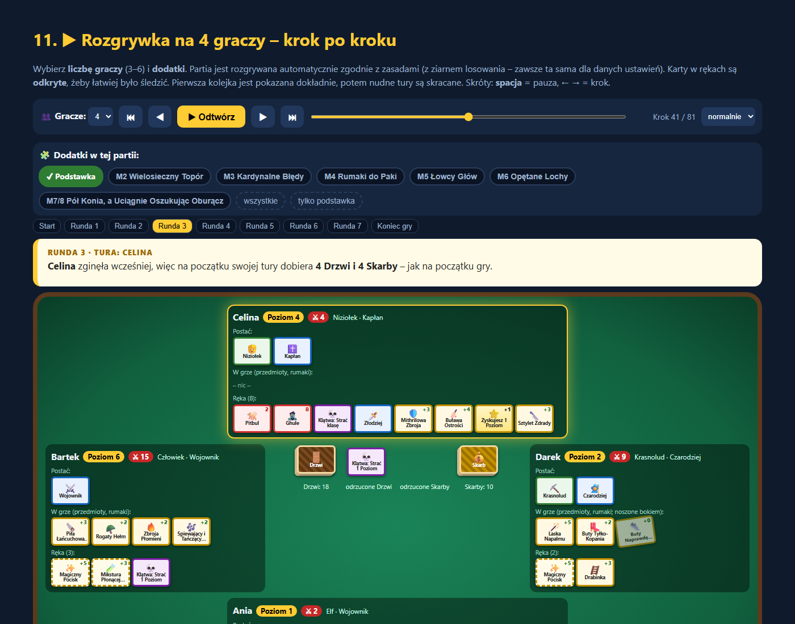

# ⚔️ Munchkin + dodatki

[← README](../README.md)

## O grze

Karciana gra dla **3–6 graczy** (polskie wydanie: Black Monk), parodia gier fabularnych. Gracze wyważają drzwi, walczą z potworami, zbierają skarby i wbijają sobie nawzajem noże w plecy. **Wygrywa pierwszy gracz, który osiągnie 10. poziom.** 10. poziom można zdobyć tylko za zabicie potwora.

## Wybór dodatków

Na stronie tytułowej, w rozdziale **Dodatki** i w panelu symulacji są przełączniki dodatków, z których korzystacie. Są też skróty **„wszystkie”** i **„tylko podstawka”**. Zmiana wyboru:

- pokazuje lub ukrywa opisy dodatków oraz rasy i klasy, które te dodatki wprowadzają;
- przelicza przykładową partię, tak żeby pojawiły się w niej karty i mechaniki z wybranych dodatków.

| Dodatek | Co wprowadza (w instrukcji) |
|---|---|
| **M2 Wielosieczny Topór** | rasa **Ork**, wzmocnienia przedmiotów |
| **M3 Kardynalne Błędy** | rasa **Gnom** (iluzje), klasa **Bard** |
| **M4 Rumaki do Paki** | **wierzchowce** i **Przydupasy** (pomocnicy, których można poświęcić przy ucieczce) |
| **M5 Łowcy Głów** | klasa **Łowca**: może oswajać potwory jako wierzchowce |
| **M6 Opętane Lochy** | **lochy** (stałe efekty), **portale** i opuszczanie lochu |
| **M7/8 Pół Konia, a Uciągnie Oszukując Oburącz** | rasy **Centaur** i **Jaszczuroludź**, **Ultra Munchkin**, **Wielorasowiec** |
| M1.5 Kości Zostały Rzucone, M3.5 Piętno Śmierci | tylko krótko opisane: to małe zestawy kart promocyjnych, więc nie mają przełącznika |

## Rozdziały instrukcji

1. Karty i elementy
2. Postać (rasy, klasy, miejsca na przedmioty, Super Munchkin, Mieszaniec)
3. Przygotowanie
4. Przebieg tury
5. Walka
6. Pomoc i psucie
7. Ucieczka i śmierć
8. Przedmioty (sprzedaż, handel)
9. Kiedy zagrywać karty i spory
10. Dodatki
11. ▶ Rozgrywka
12. Ściąga

## Streszczenie zasad

### Start

Każdy gracz zaczyna na **1. poziomie** jako człowiek bez klasy. Dostaje **4 karty Drzwi i 4 karty Skarbów**.

### Tura

1. **Wyważ drzwi:** odkryj kartę Drzwi.
   - Potwór: walczysz z nim.
   - Klątwa: działa na ciebie.
   - Inna karta: bierzesz ją na rękę albo od razu zagrywasz.
2. Jeśli nie walczyłeś:
   - **Szukaj guza**: zagraj potwora z ręki i walcz z nim; **albo**
   - **Złup pokój**: weź zakrytą kartę Drzwi na rękę.
3. **Dobroczynność:** jeśli masz za dużo kart (limit 5, Krasnolud 6), nadmiar oddajesz graczowi z najniższym poziomem. Jeśli to ty masz najniższy poziom, nadmiar odrzucasz.

### Walka

- Twoja **siła bojowa** to poziom + premie z przedmiotów.
- Wygrywasz, jeśli jest **większa** niż poziom potwora. **Wojownik** wygrywa też przy remisie.
- Możesz poprosić o pomoc **jednego** gracza. Zwykle płacisz mu częścią skarbów, na którą się umówicie.
- Inni gracze mogą przeszkadzać: wzmacniać potwora albo dorzucać **wędrujące potwory**.
- **Wygrana:** +1 poziom (lub więcej, jeśli tak mówi karta) i skarby potwora.
- **Ucieczka:** rzut kością, udana na **5–6** (Elf +1). Nieudana ucieczka oznacza **Marny Koniec**, czyli efekt opisany na karcie potwora.
- **Śmierć:** tracisz wszystkie karty i przedmioty. Zachowujesz poziom, rasę i klasę. Na początku następnej tury dostajesz nowe karty (4 + 4).

### Przedmioty

- Miejsca na przedmioty: nakrycie głowy, zbroja, obuwie, dwie ręce, jeden **duży** przedmiot, najemnik.
- Przedmioty warte razem **1000 sztuk złota** możesz sprzedać za **1 poziom**. Tak nie da się zdobyć 10. poziomu.
- Spory rozstrzyga **właściciel gry** 😉.

## Przykładowa partia

- Partie dla **3–6 graczy** są rozgrywane automatycznie, osobno dla każdej kombinacji dodatków. Ta sama kombinacja daje zawsze tę samą partię.
- W grze **tylko z podstawką** pokazane są wszystkie kluczowe sytuacje:
  - wygrana walka i walka z pomocnikiem (z podziałem skarbów);
  - udana ucieczka oraz nieudana ucieczka z Marnym Końcem;
  - klątwa i śmierć;
  - sprzedaż przedmiotów za poziom;
  - złupienie pokoju i szukanie guza;
  - dobroczynność i wzmocnienie potwora przez innego gracza;
  - wygrana Wojownika przy remisie.
- Partia na 4 graczy z samą podstawką ma 81 kroków i kończy się zwycięstwem Bartka w 7. rundzie.

Ziarna generatora: `3:3450571044, 4:134586765, 5:4246706327, 6:3084875576`. Gdy włączone są dodatki, ziarno jest modyfikowane maską wybranych dodatków: `(ZIARNO ^ Math.imul(maska, 7919)) >>> 0`.

## Uproszczenia

- **Nazwy kart:**
  - wiele nazw kart z podstawki to tłumaczenia z wersji angielskiej, niesprawdzone z polskim wydaniem;
  - nazwy i efekty lochów, nazwy portali oraz część kart z dodatków są **przykładowe**;
  - statystyki części kart z dodatków też są przykładowe.
- **Pominięte w symulacji:**
  - M1.5 i M3.5;
  - Ultra Munchkin i Wielorasowiec;
  - wzmocnienia ras i klas;
  - zdolności Jaszczuroludzia, Złodzieja i Barda oraz wskrzeszanie przez Kapłana;
  - handel między graczami.
- Oswojony przez Łowcę wierzchowiec daje premię równą liczbie skarbów potwora.

W razie rozbieżności rozstrzygają oryginalne instrukcje gry i dodatków.
