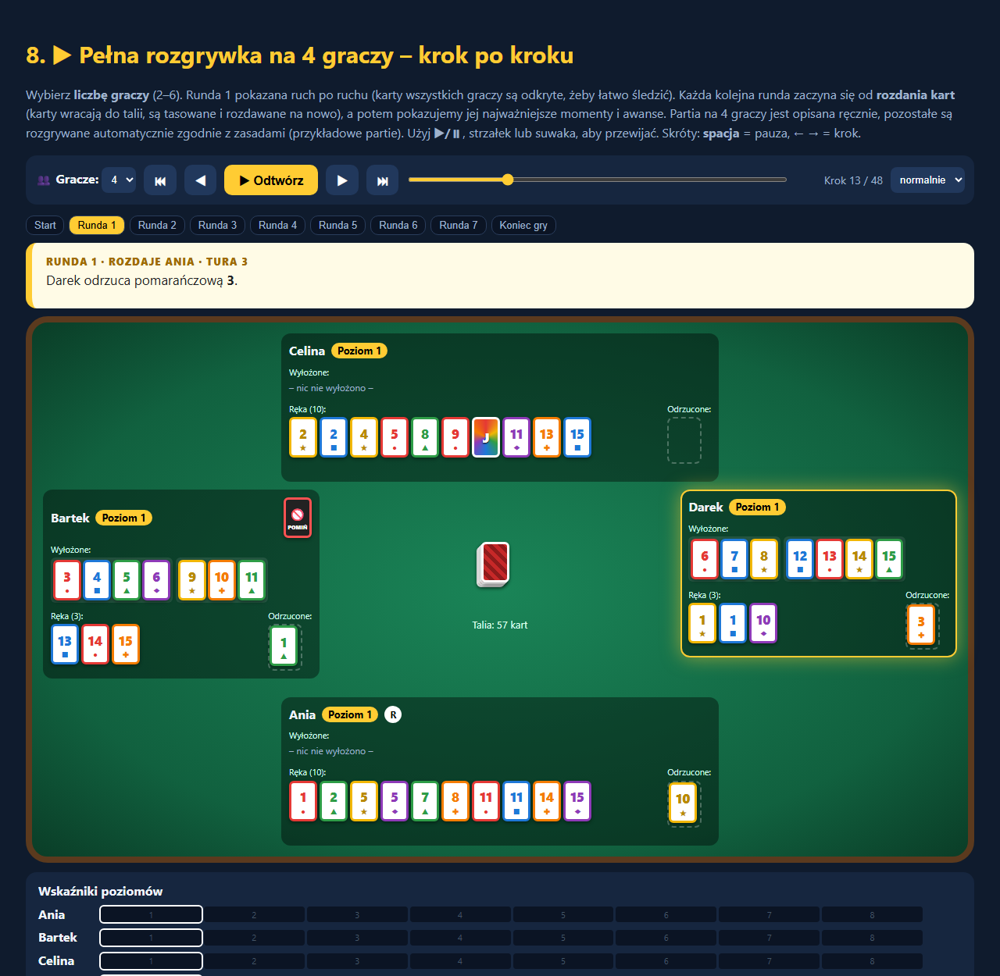

# Obsługa instrukcji

[← README](../README.md)

## Wybór gry

Na górnym pasku strony jest lista **„Gra:”**. Po wybraniu pozycji wczytuje się instrukcja danej gry. Każda gra ładuje się dopiero przy pierwszym wyborze i potem pamięta swój stan: jeśli wrócisz do wcześniej oglądanej gry, symulacja będzie w tym samym miejscu.

Wybrana gra zapisuje się w adresie strony (np. `#avel`), więc można dodać zakładkę lub wysłać link do konkretnej instrukcji.

## Budowa każdej instrukcji

1. **Strona tytułowa**: cel gry i krótki opis.
2. **Rozdziały z zasadami**: każdy z animacją lub przykładem; pasek nawigacji u góry przenosi do wybranego rozdziału.
3. **▶ Pełna rozgrywka**: interaktywna symulacja całej partii.
4. **Ściąga**: tabela z najważniejszymi zasadami.

Rozdziały pojawiają się z animacją podczas przewijania strony.

## Symulacja rozgrywki

| Element | Działanie |
|---|---|
| **👥 Gracze** | wybór liczby graczy; partia jest przeliczana i zaczyna się od początku |
| ⏮ | pierwszy krok |
| ◀ / ▶ | krok wstecz / w przód |
| **▶ Odtwórz / ⏸ Pauza** | automatyczne odtwarzanie |
| ⏭ | ostatni krok (wynik) |
| suwak | szybkie przewijanie do dowolnego kroku |
| tempo | wolno / normalnie / szybko |
| przyciski **Start, Runda 1, Runda 2, …, Koniec gry** | skok do początku rundy |

Nad planszą wyświetla się **komentarz** do bieżącego kroku: kto gra i co robi. Karty i elementy, które właśnie się zmieniły, są **podświetlone**, a ruchy kart są animowane (np. z talii do ręki).

### Skróty klawiszowe

| Klawisz | Działanie |
|---|---|
| `spacja` | odtwórz / pauza |
| `→` | następny krok |
| `←` | poprzedni krok |

> Skróty działają, gdy kursor jest nad instrukcją. Jeśli nie reagują, kliknij raz w treść strony.

### Liczba graczy

| Gra | Zakres | Partia ręczna | Partie generowane |
|---|---|---|---|
| Level 8 | 2–6 | 4 graczy | 2, 3, 5, 6 |
| Sabotażysta | 3–10 | 4 graczy | 3, 5–10 |
| Kroniki Zamku Avel | 1–4 | 4 graczy | 1 (solo), 2, 3 |

Partia ręczna ma dokładniejsze komentarze. Partie generowane są zawsze takie same (powtarzalne), bo opierają się na stałym ziarnie losowania (patrz [Budowa techniczna](budowa-techniczna.md)).

## Wymagania

- Aktualna przeglądarka: Edge, Chrome, Firefox lub Safari z ostatnich 2–3 lat.
- Włączony JavaScript.
- Brak wymagań sieciowych: plik działa offline.
