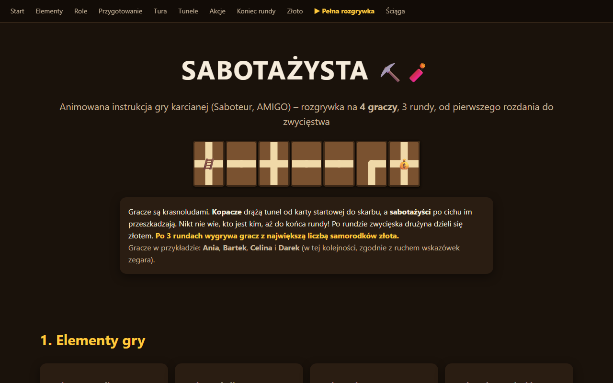

# ⛏️ Sabotażysta

[← README](../README.md)

## O grze

Karciana gra z ukrytymi rolami dla **3–10 graczy**. Gracze są krasnoludami:

- **kopacze** drążą tunel od karty startowej do skarbu;
- **sabotażyści** po cichu im przeszkadzają.

Nikt nie wie, kto jest kim, aż do końca rundy. Po rundzie zwycięska drużyna dzieli się złotem. **Po 3 rundach wygrywa gracz z największą liczbą samorodków.**

## Rozdziały instrukcji

1. Elementy gry
2. Tajne role
3. Przygotowanie rundy
4. Przebieg tury
5. Zasady kładzenia tuneli
6. Karty akcji
7. Koniec rundy
8. Podział złota i kolejne rundy
9. ▶ Pełna rozgrywka krok po kroku
10. Ściąga

## Streszczenie zasad

### Role

Do każdej rundy tasuje się **liczbę graczy + 1** kart ról. Każdy gracz losuje jedną i ogląda ją w tajemnicy, a ostatnia karta zostaje odłożona zakryta.

| Gracze | 3 | 4 | 5 | 6 | 7 | 8 | 9 | 10 |
|---|---|---|---|---|---|---|---|---|
| Sabotażyści | 1 | 1 | 2 | 2 | 3 | 3 | 3 | 4 |
| Kopacze | 3 | 4 | 4 | 5 | 5 | 6 | 7 | 7 |

### Przygotowanie rundy

- Na stole leży karta **Start** i **3 karty celu** (jedna z nich to skarb), w odstępie 7 kart od Startu.
- Liczba kart na ręce: **6** (3–5 graczy), **5** (6–7 graczy), **4** (8–10 graczy).

### Tura

1. Zagraj jedną kartę: **tunel**, **akcję**, albo **spasuj**, odrzucając kartę zakrytą.
2. Dobierz kartę, jeśli w talii jeszcze jakieś są.

### Tunele

- Wszystkie krawędzie nowej karty muszą **pasować** do sąsiednich kart.
- Karta musi mieć **połączenie ze Startem** przez ciągły tunel.
- Kart nie wolno kłaść w poprzek.

### Karty akcji

| Karta | Działanie |
|---|---|
| **Zepsute narzędzie** (kilof / lampa / wózek) | Kładziesz przed graczem; dopóki leży, gracz nie może kłaść tuneli. Przed jednym graczem może leżeć najwyżej 1 narzędzie każdego rodzaju. |
| **Naprawa** | Usuwa pasujące zepsute narzędzie. |
| **Mapa** | Pozwala potajemnie podejrzeć 1 kartę celu. |
| **Zawał** | Usuwa 1 kartę tunelu ze stołu. |

### Koniec rundy i złoto

- Tunel dotarł do **skarbu** → wygrywają **kopacze**. Ciągnie się tyle kart złota, ilu jest kopaczy, i gracze wybierają je po kolei (przeciwnie do ruchu wskazówek zegara).
- Gracze **skończyli karty**, a skarbu nie odkryto → wygrywają **sabotażyści**. Jeden sabotażysta dostaje 4 samorodki; przy 2–3 sabotażystach każdy dostaje po 3; przy 4 – po 2.
- Po rundzie wszyscy odkrywają role. W następnej rundzie role są losowane od nowa.

## Przykładowa partia

- **4 graczy**, partia opisana ręcznie: 3 rundy, przy czym **runda 1** jest pokazana ruch po ruchu, z widocznymi kartami i rolami wszystkich graczy.
- **3 i 5–10 graczy**: partie rozgrywane automatycznie według zasad.
