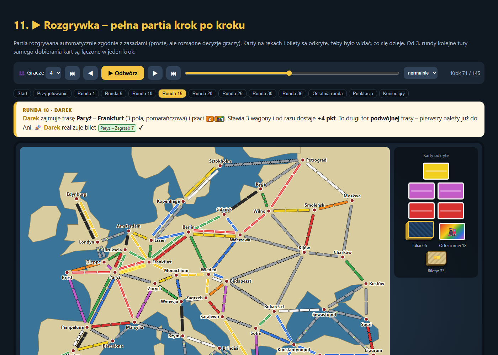

# 🚂 Wsiąść do Pociągu: Europa

[← README](../README.md)

## O grze

Gra dla **2–5 graczy**. Gracze zbierają karty wagonów, zajmują trasy kolejowe między miastami Europy i realizują bilety, czyli połączenia między dwoma miastami. Wygrywa gracz z największą liczbą punktów po końcowym podliczeniu.

## Rozdziały instrukcji

1. Elementy gry
2. Przygotowanie
3. Przebieg tury
4. Dobieranie kart
5. Zajmowanie tras
6. Tunele
7. Promy
8. Stacje
9. Bilety
10. Koniec gry i punktacja
11. ▶ Rozgrywka
12. Ściąga

## Streszczenie zasad

### Elementy

- Każdy gracz ma 45 wagonów i 3 stacje.
- Karty wagonów: 110 sztuk, czyli po 12 kart w każdym z 8 kolorów i 14 lokomotyw.
- Bilety: 46 sztuk, w tym 6 długich.

### Przygotowanie

- Każdy gracz dostaje 4 karty wagonów. Na stole odkrywa się 5 kart.
- Każdy gracz dostaje 1 długi i 3 zwykłe bilety. Zatrzymuje co najmniej 2 z nich.

### Tura

W swojej turze gracz robi **dokładnie jedną** z czterech rzeczy:

1. **Dobiera 2 karty wagonów.** Odkryta lokomotywa liczy się jak 2 karty. Lokomotywy nie wolno wziąć z odkrytych kart jako drugiej karty.
2. **Zajmuje trasę.** Płaci tyle kart w kolorze trasy, ile trasa ma pól. Trasę szarą opłaca kartami w dowolnym jednym kolorze.
3. **Dobiera 3 bilety** i zatrzymuje co najmniej 1.
4. **Stawia stację.** Pierwsza stacja kosztuje 1 kartę, druga 2 karty, trzecia 3 karty w jednym kolorze.

### Zasady specjalne

| Zasada | Opis |
|---|---|
| **Lokomotywy** | Zastępują karty dowolnego koloru. Jeśli wśród odkrytych kart są 3 lokomotywy, wszystkie 5 odkrytych kart trafia na stos kart odrzuconych i odkrywa się nowe. |
| **Trasy podwójne** | Jeden gracz może zająć tylko jeden z dwóch torów. Przy 2–3 graczach można używać tylko jednego toru. |
| **Promy** | Trasę opłaca się m.in. tyloma lokomotywami, ile pokazuje symbol na trasie. |
| **Tunele** | Gracz odkrywa 3 karty z talii. Za każdą kartę w kolorze trasy oraz każdą lokomotywę dopłaca 1 kartę. Może też zrezygnować z zajęcia tunelu. |
| **Stacje** | Na koniec gry pozwalają użyć do realizacji biletów jednej trasy przeciwnika, która wychodzi z miasta ze stacją. |

### Koniec gry

Gdy któryś gracz ma **0, 1 lub 2 wagony**, każdy gracz, także on, rozgrywa jeszcze **jedną ostatnią turę**.

### Punktacja

| Długość trasy | 1 | 2 | 3 | 4 | 6 | 8 |
|---|---|---|---|---|---|---|
| Punkty | 1 | 2 | 4 | 7 | 15 | 21 |

- Bilety: zrealizowany bilet daje tyle punktów, ile na nim jest. Niezrealizowany tyle samo odbiera.
- Każda niewykorzystana stacja daje **+4 pkt**.
- **Europejski Ekspres** daje **+10 pkt** za najdłuższą nieprzerwaną trasę. Przy remisie bonus dostaje każdy z remisujących graczy.

## Przykładowa partia

Partie dla **2–5 graczy** są rozgrywane automatycznie według zasad. Karty na rękach i bilety są odkryte, żeby było widać, co się dzieje. Od 3. rundy kolejne tury, w których gracze tylko dobierają karty, są łączone w jeden krok.

W każdej partii są pokazane: tunel z dopłatą, prom, postawienie i wykorzystanie stacji, trasa podwójna, dobieranie nowych biletów i wymiana kart po 3 lokomotywach.

Ziarna generatora: `2:288, 3:169, 4:205, 5:147`.

## Uproszczenia

- Sieć tras jest odtworzona jak najwierniej, ale **nie została porównana z drukowaną planszą**. Linia brzegowa mapy jest schematyczna.
- Komputerowi gracze planują trasy z wyprzedzeniem i stawiają najwyżej 2 stacje.
- Przy podliczaniu biletów każda stacja automatycznie korzysta z tej trasy przeciwnika, która daje najlepszy wynik.

W razie rozbieżności rozstrzyga oryginalna instrukcja gry.
